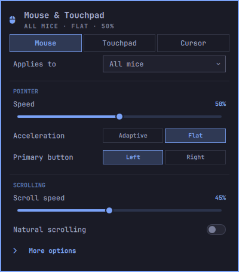
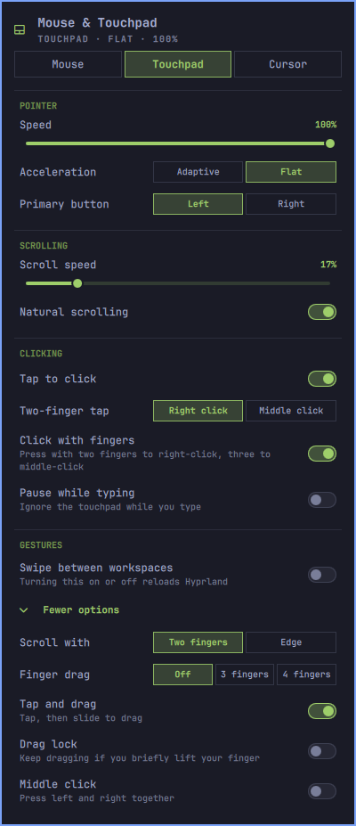
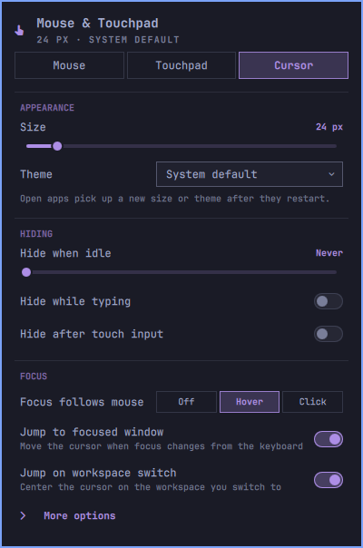

# Mouse & Touchpad

Omarchy bar widget for pointer settings, with separate tabs for your mice, your
touchpad, and the cursor. It follows your Omarchy theme: each tab takes its own
color from the theme palette.

<p align="center">
  
  
  
</p>

Based on [wouldja/omarchy-mouse](https://github.com/wouldja/omarchy-mouse).

## Install

```sh
omarchy plugin add https://github.com/T3mon/omarchy-pointer.git --enable
```

Click the mouse icon in the bar to open the panel. Scroll over the icon to nudge
the pointer speed of the tab you last had open.

## Settings

### Mouse

| Section | Options |
|---|---|
| Applies to | **All mice**, or one connected mouse with **Own settings** |
| Pointer | Speed, acceleration (adaptive or flat), primary button |
| Scrolling | Scroll speed, natural scrolling |
| More options | Raw input, middle-button scrolling, click to lock |

### Touchpad

Shown when a touchpad is detected. Everything here is separate from the mouse.

| Section | Options |
|---|---|
| Pointer | Speed, acceleration, primary button |
| Scrolling | Scroll speed, natural scrolling |
| Clicking | Tap to click, two-finger tap action, click with fingers, pause while typing |
| Gestures | Swipe between workspaces, finger count, swipe distance, invert direction |
| More options | Scroll with two fingers or the edge, three/four-finger drag, tap and drag, drag lock, middle click |

### Cursor

| Section | Options |
|---|---|
| Appearance | Size, theme |
| Hiding | Hide when idle, hide while typing, hide after touch input |
| Focus | Focus follows mouse (off, hover, click), jump to focused window, jump on workspace switch |
| More options | Resize from borders, zoom |

Options that only matter together appear together: the swipe settings show up
when swipe is on, and drag lock when tap and drag is on. The panel warns about
settings that need attention, such as raw input bypassing your speed, swipe and
finger drag using the same number of fingers, or zoom staying on after a
restart.

The whole panel works from the keyboard: arrow keys move between controls,
Enter toggles or picks, and Escape closes it.

## How the settings stay separate

| Setting | Where it is written |
|---|---|
| All mice | `input` |
| One mouse with Own settings | `hl.device` for that mouse |
| Touchpad speed, acceleration, primary, scroll method | `hl.device` per touchpad |
| Touchpad scroll, tap, drag options | `input.touchpad` |
| Swipe gestures | `hl.gesture` and `gestures` |
| Cursor | `cursor`, `general`, `input.follow_mouse`, cursor env vars |

Touchpads are the pointers whose name contains `touchpad` or `trackpad`; every
other pointer from `hyprctl devices` is listed as a mouse.

## What it changes

Dragging a slider applies values live through `hyprctl eval`. Releasing it, or
any click, also writes:

- `~/.config/hypr/pointer.lua`: generated settings, with the panel state on its
  second line
- `~/.config/hypr/hyprland.lua`: adds `require("hypr.pointer")` after
  `require("hypr.input")` if missing (a `.bak.<pid>` copy is kept)

Because `pointer.lua` loads after `input.lua`, it wins over pointer settings
there. On first open, existing `hl.device` blocks for your devices in
`~/.config/hypr/*.lua` are read so their values are kept.

Changing swipe gestures reloads Hyprland. Changing cursor size or theme also
runs `hyprctl setcursor` and updates the GNOME cursor settings for GTK apps.

It never edits `/usr/share/omarchy` and never asks for elevated permissions.

## Remove

```sh
omarchy plugin remove t3mon.pointer
rm ~/.config/hypr/pointer.lua
```

Then delete the `require("hypr.pointer")` line from `~/.config/hypr/hyprland.lua`.

## Tests

```sh
node tests/model.test.js
python3 -I tests/test_apply.py
```

## License

MIT. Needs Omarchy (Quickshell), Hyprland, and Python 3.
